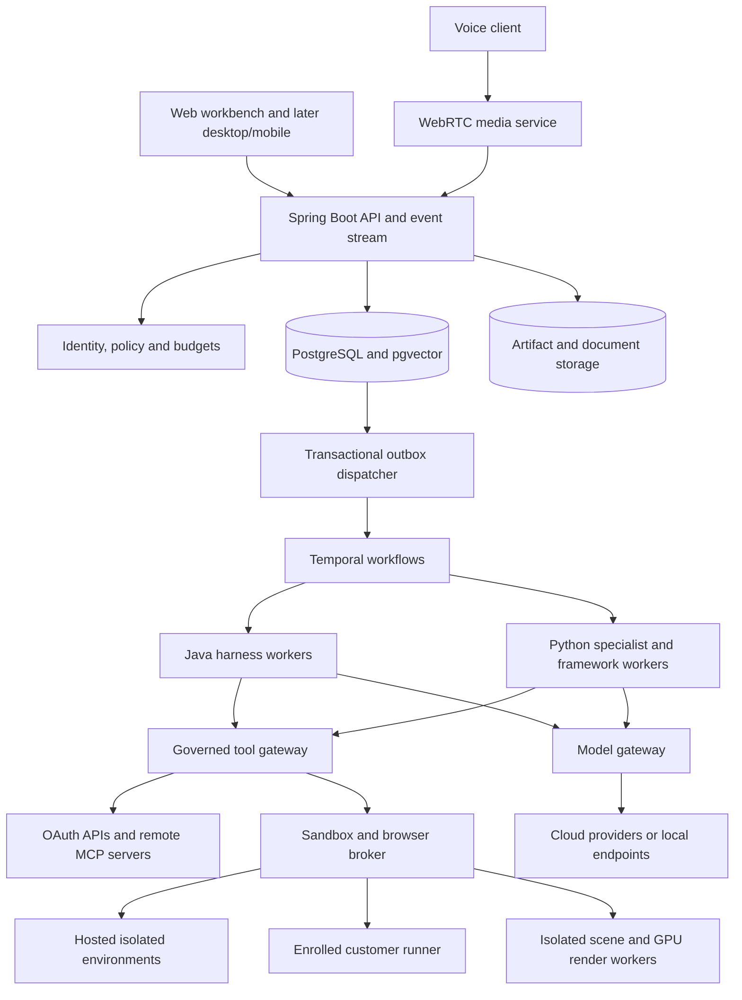

# Zincc architecture

The user approved the architecture plan on 18 November 2026. P1.1 implements the Java control-plane entry point in `io.zincc`. Future feature packages sit directly below that root. Build checks reject package cycles and dependencies on the launcher. The service binds to IPv4 loopback by default and exposes aggregate Actuator health. The sections below describe the full target architecture. See the [running component](docs/learning-notes/006-spring-foundation.md), [technology baseline](docs/technology-baseline.md), and [decision records](docs/architecture-decisions/README.md).

The [engineering learning roadmap](docs/learning-roadmap.md), added 15 November, explicitly maps high/low-level system design and AI/inference topics to component evidence and labs. System-design learning applies throughout this architecture, including capacity, consistency, failure domains and operational trade-offs.

## 1. Boundaries

P2.2 stores each personal conversation in the member’s workspace. PostgreSQL allocates replay sequence numbers under a per-conversation lock. The browser can reconnect independently of generation. [Conversation decision](docs/architecture-decisions/0012-conversation-replay.md)

OpenRouter uses the OpenAI chat-completions wire protocol with a distinct provider ID, fixed HTTPS origin and separate credential. The opt-in free profile registers two explicitly selectable text routes. [Model gateway](docs/modules/model-gateway.md)

P2.1 introduces the internal `io.zincc.model` boundary. Callers choose an explicit route. The gateway validates request capabilities, translates provider responses into text or stream events, and records reported usage. Configuration keeps provider clients behind this boundary. Conversation persistence and automatic route selection have separate tasks. [Gateway contract](docs/modules/model-gateway.md)

P1.4 adds a same-origin React client. The optional Maven workbench profile packages built assets into the Spring JAR. A restricted directory function lists only the signed-in identity's memberships. Opening a selected workspace uses the independent P1.2 authorization check. [Workbench contract and deployment](docs/modules/workbench.md)

P1.3 adds an OIDC browser session boundary. The `identity` package resolves a validated issuer and subject to an internal principal, then calls the `workspace` package to check membership for each workspace read. [Identity decision](docs/architecture-decisions/0011-browser-identity.md)

P1.2 implements the first feature package, `io.zincc.workspace`. Its membership lookup uses transaction-local identity and workspace context, separate schema-owner and runtime roles, and PostgreSQL row-level policies. The `postgres` profile enables it. [Workspace access decision](docs/architecture-decisions/0010-workspace-access.md)

**Additive proposal, 16 November:** [connected AI engines](docs/modules/connected-ai-engines.md) distinguishes model connections (including eligible direct plan use) from external agent runtimes (Codex app-server, Claude Code, Grok Build/ACP). A qualified local/isolated worker hosts the external engine; Spring/Temporal still own identity, outer execution and governed actions. This does not replace the native harness or framework adapters. See proposed ADR 0009.

Start with a **Spring Boot modular monolith for the trusted control plane**, separate durable workers, and disposable execution sandboxes. A module boundary is a code ownership and data access rule; it need not be a network hop. Split a module into a service only when isolation, resource use, deployment cadence, or measured scale requires it.



The diagram shows logical relationships, not a promise that all services launch in the first task. Voice, remote runners, framework adapters, and distributed caches enter later.

## 2. Control-plane modules

| Module | Owns | Must not own |
| --- | --- | --- |
| Identity and tenancy | Users, organizations, workspaces, membership, service identities | Provider credentials in ordinary account rows |
| Projects and conversations | Project scope, messages, attachments, conversation versions | Workflow retry logic |
| Agents and skills | Immutable published definitions, drafts, manifests, tool grants | Direct execution of uploaded code |
| Runs and automations | Run requests, trigger configuration, UI projections, cancellation requests | Raw media or enormous workflow payloads |
| Policy and actions | Authorization decisions, approvals, idempotency records, receipts | Trusting model text as authorization |
| Connections | OAuth lifecycle, secret references, sync cursors, webhook verification | Returning refresh tokens to an LLM |
| Knowledge and artifacts | Documents, provenance, datasets, citations, artifact versions | Treating vector similarity as truth |
| Models and usage | Capability catalogue, route policies, usage, budget reservations | Hardcoded flagship model dependency |
| Execution | Environment leases, runner enrolment, job placement, resource limits | Tenant code inside the API process |
| Operations | Audit, telemetry, admin diagnostics, retention jobs | Full private prompts in default logs |

Use package-by-domain, explicit public application interfaces, dependency injection, and tests that forbid prohibited module dependencies. Use transactional application services; avoid both controller-to-repository business logic and a generic abstraction for every class. Keep domain behavior independent of provider DTOs.

Suggested future layout (not existing code):

```text
apps/web/
services/control-plane/
services/workflow-worker/
workers/python/
workers/browser/
packages/contracts/
infra/local/
infra/deploy/
evals/
docs/
```

## 3. State ownership and data model

**PostgreSQL** owns product records, policy, action receipts, usage, and materialized run views. **Temporal history** owns durable workflow progression. **Object storage** owns large immutable payloads. Each record includes an owner, workspace, lifecycle state, and revision where relevant. Avoid storing the same mutable state independently in two authoritative systems.

Initial entity groups:

- Organization → workspace → membership/project, with personal workspaces using the same isolation model.
- Agent → agent_version → skill/tool grants; automation → trigger → trigger_delivery.
- Conversation → message; run → step → event; parent_run links bounded child runs.
- Connection → credential_reference → resource_grant; tool_definition → tool_version.
- Action_intent → approval → action_attempt → receipt; idempotency keys scoped to actor and operation.
- Document → document_version → page/block/table/chunk → index_generation; citation points to immutable evidence.
- Dataset → dataset_version → transformation → dashboard/artifact_version.
- Memory_item → evidence_reference → correction/deletion record.
- Budget → reservation → usage_entry; outbox_event; audit_entry; runner → environment_lease.

Use foreign keys that preserve tenant scope, unique constraints for deduplication, optimistic revisions for edits, UTC timestamps plus explicit user scheduling time zones, and decimal types for money. Store provider-reported usage separately from estimates and adjustments.

Tenant isolation: authorization in application services plus PostgreSQL row-level policies for sensitive tenant tables. A transaction-scoped tenant context must not leak through connection pooling. Runtime database roles must not bypass policies; migrations use a different role. Test cross-tenant joins, guessed IDs, search results, exports, background jobs, and signed download URLs.

Tenant isolation is not enough for people sharing one workspace. Runs additionally carry initiator, effective principal, delegation chain and output audience. A shared agent does not inherit its owner's private connections for every caller. Derived artifacts retain source restrictions unless an explicit release authorizes a new audience. [ADR 0008](docs/architecture-decisions/0008-delegated-authority-and-data-sharing.md) defines this boundary.

## 4. A request from acceptance to completion

1. Client sends a request with an idempotency key and intended project/agent revision.
2. Spring validates identity, permissions, input shape, capability availability, and budget. It commits a run request and outbox event in one database transaction.
3. Dispatcher starts a Temporal workflow using a stable workflow ID. Repeated deliveries converge on the same logical run. A reconciliation job repairs stuck dispatch records.
4. Workflow schedules an activity that assembles a versioned context and invokes the chosen harness. Model calls, network I/O, and database changes happen in activities, never deterministic workflow code.
5. The harness returns a proposed tool action or a candidate answer. The tool gateway validates the structured intent and current policy.
6. If approval is required, execution waits durably. Approval identifies the exact action payload and expires. Changed payloads require a new decision.
7. Gateway records dispatch and obtains an external receipt. Verification checks the actual result, not the model's claim of success.
8. Completion produces an artifact or answer with evidence. Usage settles; projections update; the client receives sequenced events and can reconnect from its cursor.

An HTTP acknowledgement means “accepted,” not “finished.” Model stream termination is not task completion. A browser click is not a verified external write.

## 5. Durable execution and action semantics

Use Temporal once real background work is introduced. It supplies durable waits and retry scheduling; operational cost includes another service, persistence, workflow versioning, and history management. Without it, Zincc would have to build these mechanisms around a database queue. [Temporal workflow documentation](https://docs.temporal.io/workflows) informs this choice.

Workflow code must be replay-safe. Persist large transcripts and tool results in object storage and pass references. Use activity deadlines, cancellation, heartbeats for long operations, bounded histories, workflow versioning, and continuation for long-lived automations. Separate workflow workers from request-serving replicas.

External effects cannot generally be made exactly once by a workflow engine. The action ledger records prepared, awaiting approval, dispatched, succeeded, failed, or **outcome unknown**. Use provider idempotency keys when supported. Otherwise reconcile against provider state before any retry. A timed-out email send must not silently send a second email.

Database state changes and an external API cannot share an ordinary ACID transaction. Use outbox delivery, explicit state transitions, and compensating operations where meaningful. Compensation is a new audited action, not a magical rollback of an email already read.

Concurrent work uses bounded fan-out, independent evidence outputs, and explicit merge ownership. Serialize actions that modify the same resource; use leases with fencing tokens where a worker can outlive its lease. A stale worker must fail its final write even if it still believes it owns the task.

Lease generations must never reset on release/recreation; preserve a tombstone or combine a new environment incarnation with its monotonically increasing fence. Fence checks occur at the actual executor/commit boundary. For third-party APIs without fencing, use single dispatch ownership and receipt reconciliation; a database lease cannot revoke an HTTP request already in flight.

## 6. API and event contracts

Use versioned REST/OpenAPI contracts for product APIs; SSE for durable task updates; WebSocket where bidirectional live control needs it; WebRTC for voice media. Generate typed clients from the contract and validate boundary payloads.

Proposed operations: create run, read run, cancel run, respond to approval, create agent version, enrol runner, test connection, create upload, retrieve citations, and read usage. Resource names and exact routes will be specified in the component task, not guessed by UI code.

Run events carry event_id, run_id, monotonically increasing sequence, timestamp, schema_version, type, and sanitized payload. Reconnect may repeat events; clients deduplicate. Sensitive tool output and provider reasoning are not blindly exposed as progress events. Show decisions, evidence, and concise explanations instead of storing private chain-of-thought.

Worker contracts include StartRun, ResumeRun, CancelRun, EmitEvent, ProposeToolCall, StoreArtifact, and Checkpoint. They carry tenant identity, trace context, deadlines, capabilities, policy revision, and immutable agent version. Workers authenticate as scoped service principals.

The [AG-UI mapping](docs/modules/agent-ui-contract.md) is a compatibility boundary, not a second source of truth. Keep presentation patches separate from authoritative records, sanitize raw/provider fields, and recover expired event cursors using a scoped snapshot. Browser closure/disconnection does not cancel a durable run; cancellation is an explicit authenticated command. Mid-run steering creates a versioned instruction event applied at a safe checkpoint; changed action payloads invalidate prior approval.

## 7. Storage, caching, and search

- PostgreSQL first for transactions, metadata, full-text retrieval, and pgvector. Full-text ranking is not automatically BM25.
- S3-compatible storage for source documents, media, checkpoints, and artifacts. Select an actual managed or self-hosted implementation after deployment constraints and licensing are known; a filesystem adapter is sufficient for early local development.
- In-process bounded caches initially. Add Valkey for shared short-lived cache/rate-limit state when multiple replicas require it. It is not the source of truth for money, policy, or action completion.
- Isolated DuckDB/Arrow workers for analytical transformations when introduced. Never run model-generated SQL against the product database.
- No initial Kafka, graph database, dedicated vector database, or search cluster. Introduce one only with evidence the current design cannot meet requirements.

Detailed cache invalidation and context ownership are in [runtime design](docs/modules/agent-runtime.md). Document indexing and extraction are in [knowledge design](docs/modules/knowledge-and-analytics.md).

Scene Studio adds immutable source/asset manifests, review evidence and render-job outputs to the existing artifact domain. It uses a separate media queue and qualified browser/GPU workers through the execution broker. Interactive previews and frame-addressed exports have distinct runtime contracts; generated scripts never run in the Spring process or trusted workbench origin. [Scene design](docs/modules/scene-studio.md) and [ADR 0007](docs/architecture-decisions/0007-code-generated-scenes.md) specify timing, sandbox, cache and recovery boundaries.

## 8. Deployment and scale

Development: local API, PostgreSQL, object-store adapter, and workers added per phase; Docker Compose when available. Temporal becomes a local dependency with durable runs. Do not require Kubernetes to understand or run the early product.

Hosted alpha: API/worker containers, managed PostgreSQL/object storage, isolated execution hosts, managed or self-hosted Temporal. Use separate queues for interactive, ingestion, media, and scheduled work so a long video does not block an inbox answer. Enforce tenant fairness, admission limits, backpressure, and global provider quotas.

Private deployment: same contracts with customer-managed identity, storage, model endpoints, and runners. Fully offline mode must eliminate cloud fallbacks and external telemetry; connectors requiring the internet remain unavailable. Windows Docker/WSL is not automatically an offline native desktop agent.

Scale independently by queue lag, CPU/GPU pressure, provider limits, and tenant quotas. PostgreSQL connection pooling, slow-query inspection, bounded indexes, and archival come before speculative sharding. Separate tenancy into dedicated infrastructure when contractual isolation or workload justifies it.

The [deployment and operations contract](docs/modules/deployment-and-operations.md) defines four profiles, capacity assumptions, admission/fairness, failure responses and proposed service objectives. It supersedes interpreting “100 active runs” as 100 simultaneous compute sessions. Persistent local automation has a real service footprint; minimum hardware remains to be measured.

## 9. Operations, quality, and recovery

Use structured logs, trace IDs, OpenTelemetry spans, and metrics for task success, queue age, tool error rate, model latency, token/cost usage, approval delay, citation validity, and sandbox health. Redact secrets and default to metadata-only observability. User-visible audit records are distinct from short-lived debug logs.

Each component gets relevant tests: domain tests, database integration tests, provider contract fixtures, replay/recovery tests, adversarial permission cases, and end-to-end user journeys. Evaluation datasets are versioned separately from prompts. A model judge is supplementary; deterministic checks and human review anchor the difficult cases.

Release controls: locked dependencies and image digests, vulnerability and secret scanning, SBOM, migrations using expand/contract changes, staged rollout, rollback rehearsal, and backward-compatible worker contracts. Avoid deploying workflow-breaking code without a version migration strategy.

Backups must include PostgreSQL, object versions, encryption-key recovery, and the workflow service's persistence. Proposed initial production objectives: RPO at most 15 minutes and RTO at most four hours, subject to budget and an actual restore drill. These are design targets, not achieved guarantees. Deletion and retention must cover derived indexes, memories, cached results, exports, and backups according to documented policy.

Workflow histories and failure payloads also need privacy/retention controls; use opaque content references and qualified payload encryption. Restore into quarantine with external dispatch disabled, reconcile effects and deletion/revocation records, then resume. Restoring an old state must not resurrect a deleted document or repeat a completed external action. Details and adoption evidence are in the operations contract.

## 10. Architecture acceptance gates

Before public multi-tenant use: prove tenant isolation; revoke credentials during an active run; kill/restart workers around an external write; restore from backup; reconnect streams; exhaust budgets concurrently; inject hostile document instructions; and show an ambiguous action outcome without duplication.

Before claims of model portability: run the same contract and task suite against at least two cloud providers and one local model. Before calling a mode fully local: verify network egress and every configured fallback. Before claiming a performance benefit: publish the workload, environment, baseline, and failure rate.
