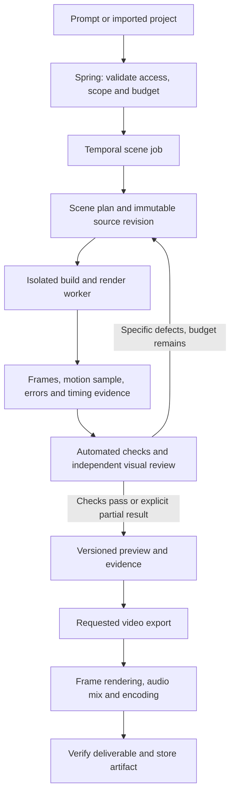

# Scene Studio: code-generated worlds and video

Date: **15 November 2026**. Status: **proposed product capability; research and specification only**. No renderer, scene, model loop, export or integration has been implemented or benchmarked. Working feature name: **Zincc Scene Studio**.

## 1. User outcome

A user describes a scene or supplies HTML/JavaScript, previews the result, asks for changes, and chooses an interactive experience or a rendered video. Example: “Create an underwater garden with fish and a shipwreck; let me explore it, then make a 30-second cinematic tour.” Coding is optional for the user; editable source is retained.

| Capability | User-visible result |
| --- | --- |
| Prompt to scene | Procedural worlds, product scenes, scientific illustrations, data stories and motion graphics |
| Import and edit | Inspect an uploaded project, describe supported behavior, revise code or exposed parameters, retain earlier versions |
| Explore | Keyboard/mouse or suitable touch controls, pause, mute, viewpoints and quality presets |
| Direct a film | Camera keyframes, duration, aspect ratio, titles, transitions and a finite timeline |
| Revise through conversation | “Make the water brighter,” “slow the camera,” or “show the revenue change as an animation” |
| Export | Qualified MP4/WebM profiles, image/poster output, editable project bundle; self-contained HTML when dependencies/assets permit |
| Add sound | Narration, captions, licensed music or procedural sound, with explicit audio settings |
| Reuse | Versioned templates and brand settings; automation can refresh a scene from an authorized dataset |
| Share | Private artifact preview and download; publication is a separate destination-specific action |

An interactive simulation and a video are separate outputs. HTML is the container; JavaScript, CSS/SVG/Canvas, GPU shaders and optional media produce the moving image. The renderer runs the scene without calling an LLM for every frame. Code-generated animation complements image/video-model clips; it does not replace every form of cinematography.

## 2. Reference findings and adaptation

The supplied post resolves to [Noniv/abyssal-garden](https://github.com/Noniv/abyssal-garden), credited by its author as u/Any-Reputation8118. The author describes an asset-free WebGPU environment and live synthesized sound. Public text currently varies between 96 KB and 97 KB; neither its exact byte size nor its performance was independently reproduced. [Author README](https://raw.githubusercontent.com/Noniv/abyssal-garden/main/README.md).

Its [original prompt](https://raw.githubusercontent.com/Noniv/abyssal-garden/main/prompt.txt) separates visual review from frame-time measurement. Adapt this into a bounded critic loop with fixed views and motion samples. Do not inherit its particular GPU target or “no engine” constraint as platform requirements. The [development code](https://raw.githubusercontent.com/Noniv/abyssal-garden/main/source/src/dev.js) fixes resolution during its timed camera path and reports timing distributions; a quality preset must similarly be fixed when Zincc compares performance.

The [build script](https://raw.githubusercontent.com/Noniv/abyssal-garden/main/source/build.mjs) combines readable source modules into HTML. This supports a useful distinction: keep maintainable project files internally, bundle only for delivery. We will measure UTF-8 bytes and compressed transport bytes separately and preserve notices; we will not copy its concatenation/minification approach blindly.

[Hyperframes](https://github.com/heygen-com/hyperframes) remains the leading candidate for the HTML/video adapter. Its documented [frame contract](https://raw.githubusercontent.com/heygen-com/hyperframes/main/docs/concepts/frame-adapters.mdx) requires repeatable seeking; the exported custom adapter interface is explicitly experimental v0. Zincc owns a small internal contract so upstream API changes do not become product-wide changes. Integration and WebGPU capture remain qualification tasks.

Reference disposition, reviewed files and license evidence are recorded in [the reuse ledger](../research/references.md). No upstream source, prompt, skill or installer was copied or executed.

## 3. Technology choices

| Concern | Proposed approach | Why / alternative |
| --- | --- | --- |
| Product backend | Existing Spring Boot control plane | Reuse tenancy, artifacts, permissions, budgets and action receipts |
| Durable jobs | Existing Temporal workflow and media queue | Recover expensive steps without holding HTTP requests; no GPU or model calls inside deterministic workflow code |
| Browser authoring/runtime | TypeScript/JavaScript; DOM/CSS/SVG/Canvas for 2D | Choose the simplest suitable rendering path |
| General 3D | Three.js candidate with WebGPU/WebGL2 capability profiles | Higher-level scene primitives reduce custom engine maintenance |
| Specialized procedural work | Opt-in raw WebGPU/WGSL profile | Custom compute/shaders and compact delivery where justified; no automatic WebGL translation |
| Browser control | Existing isolated browser worker; Playwright/Puppeteer adapter selection at implementation | Reuse sandbox contracts; Hyperframes can retain its own capture driver internally |
| Video capture/encoding | Hyperframes candidate behind adapter; FFmpeg for qualified encoding/mixing | Existing engine reduces custom capture work; direct frame capture is the fallback if conformance fails |
| Audio | Existing speech adapter; offline synthesis/mixing for export | Live Web Audio playback alone is not an exported soundtrack |
| Code/visual models | Capability-routed code generator and vision reviewer | No mandatory Claude model or provider; local models require the same evaluation gates |

Three.js documents a WebGL2 backend fallback for its WebGPURenderer, but that is not a guarantee every WebGPU-only feature works on WebGL2. A scene manifest declares required capabilities and an actual tested fallback. [Three.js renderer documentation](https://threejs.org/docs/pages/WebGPURenderer.html).

Pin stable library releases, browser build, fonts, encoder build/codecs and worker image at each implementation task. Do not introduce floating dependencies now. Browser/GPU support is detected, not inferred solely from a browser name. Use HTTPS or a qualified trustworthy local origin; handle a missing adapter or device loss explicitly. [WebGPU specification](https://www.w3.org/TR/webgpu/).

## 4. Execution flow and agent roles

1. Collect the brief, input rights/provenance, desired deliverables, duration/size, style, camera behavior and resource ceiling. Use sensible defaults with visible settings; ask only when a material choice is unresolved.
2. Create a structured scene plan and immutable manifest. Route simple 2D edits to a cheaper capable model; use a stronger code model when complexity or failed checks justify it. Local-only policy applies to code, screenshots, source data and audio.
3. Generate or revise source in an isolated workspace. Resolve dependencies from a controlled registry into a pinned build, never arbitrary install commands from model output. Imported HTML gets an inspection result; unsupported code may need adaptation before export.
4. Build, load and exercise the preview. Collect console/shader errors, requested views, movement checks and a short motion sample. Verify hardware acceleration before describing any run as a GPU benchmark.
5. Give the visual reviewer the brief, rubric and rendered evidence, withholding generator reasoning and source during the visual review. It returns locations/timestamps, severity and concrete defects. A separate technical validator handles code/runtime issues. This reduces one source of bias; it does not guarantee independent correctness.
6. Patch a new revision, rerun affected checks, preserve the best known result. Start with a configurable three-repair ceiling plus time/cost limits. Stop on success, stagnation, unsupported capability or exhausted budget; show remaining defects rather than claiming perfection.
7. Render the selected revision and export settings. Verify playback, duration, dimensions, frame count, audio/captions and provenance before reporting completion.

Roles are logical responsibilities, not a requirement to run many models on every request. Independent checks may run concurrently under the existing P7 budget/concurrency controls. One coordinator owns revision selection; two agents cannot silently overwrite the same scene. A critic never authorizes publication or relaxes sandbox policy.

## 5. Scene and render contracts

These are proposed contracts, not existing classes or APIs:

- **Scene manifest:** schema version, tenant/project, source/asset hashes, dependency locks, renderer profile, seed, required GPU features/limits, fonts, dimensions, rational FPS, duration/frame count, camera track, audio track, provenance and allowed runtime capabilities.
- **Runtime lifecycle:** initialize pinned assets, expose interactive controls, evaluate a frame or replay a fixed-step simulation, signal readiness, return diagnostics, dispose resources. Every call has limits and a schema version.
- **Review result:** evidence identifiers, camera/time, defect category/severity, confidence, suggested repair, regression results, model/version and usage. Keep a concise diagnosis, not private chain-of-thought.
- **Render job:** immutable revision and profile, state, lease/fencing token, progress, chunk/checkpoint references, cancellation and final artifact checksums. Publish a manifest only after all required outputs are verified.

Interactive preview may use requestAnimationFrame for pacing. Export uses an explicit frame index: time is derived from index and FPS, not how long the worker has been running. Pin random seeds, pre-resolve assets and wait for rendering/readback completion. Do not assume a ready promise proves pixels are finished unless the capture integration verifies that contract.

Prefer analytical time-based motion for seekable scenes. Stateful simulations need fixed-step replay and validated checkpoints or pre-baking. A seed alone cannot make a stateful world support arbitrary seeks. Parallel chunks require a common correct initial state and continuity checks; otherwise render sequentially. Interactive camera input must become a recorded path or an explicit directed path for export.

Repeatability is qualified within a pinned render profile. Floating-point GPU behavior, fonts, drivers and codecs can vary across machines, so cross-hardware byte-identical output is not promised. Use strict hashes for immutable inputs and appropriate image/motion tolerances for visual comparisons. [Hyperframes timing guidance](https://raw.githubusercontent.com/heygen-com/hyperframes/main/docs/concepts/determinism.mdx).

## 6. Isolation, resources and recovery

Generated HTML/JavaScript is executable untrusted code. A preview uses an isolated artifact origin with no Zincc session cookies or credentials, constrained iframe/message capabilities and CSP. A controlled asset broker resolves allowed resources before execution. Hosted workers additionally deny private-network/metadata access and unauthorized outbound traffic. Uploaded scripts never execute in Spring or the trusted workbench origin. Source inspection alone is not a security boundary.

Preview actions such as pointer lock, audio start and fullscreen are explicit user interactions. Do not give scenes camera, microphone, clipboard, account tokens or arbitrary filesystem access. Provide a visible escape/pause control. Keep protected business data out of publicly shared scene bundles unless explicitly included in that publication.

Qualify GPU workers separately from ordinary sandboxes: device access and driver sharing alter the isolation boundary. Enforce CPU/RAM/GPU scheduling, wall time, output size and per-tenant concurrency. Browser resource watchdogs and worker recycling handle hangs. Do not copy insecure browser flags from demonstrations; Chrome's [headless GPU testing guide](https://developer.chrome.com/blog/supercharge-web-ai-testing) is environment research, not a production launch configuration.

Use frame batches or bounded streaming to avoid holding a whole raw movie in RAM. Persist completed outputs/checkpoints outside disposable workers. Retry only against immutable job inputs; invalidate incomplete chunks; a stale worker cannot publish after its lease expires. Cancellation stops new work, terminates/recycles workers as necessary and leaves a truthful partial/cancelled state. GPU commands may not stop instantaneously.

Cache build/assets/frames using tenant scope, source/asset hashes, seed, camera/timing settings, renderer/browser/font/encoder profile and relevant hardware signature. Never reuse a render across changed source, permissions or profiles. Revocation/deletion covers previews, derivatives, checkpoints and cached frames. Public templates and private data-bearing scenes have different sharing scopes.

The enrolled customer runner may supply compatible local GPU capacity after qualification. Local-only mode cannot silently move rendering or visual critique to a cloud worker. Without suitable hardware, show supported 2D/reduced options or an unavailable capability; do not mislabel a slow software path as GPU performance.

## 7. Quality gates

| Gate | Required evidence |
| --- | --- |
| Functional | Scene loads, exposed controls work, edits create a new version, previous revision restores |
| Visual | Fixed views plus a temporal sample; defect rubric and user review for subjective style |
| Runtime | No unhandled errors; shader compilation, device loss and missing capability paths tested |
| Performance | Declared hardware/browser/profile, startup time, frame-time distribution, memory/resource observations and export throughput |
| Export | Seek/replay conformance, correct frame count/duration, camera motion, audio sync, caption visibility, playable file |
| Isolation | Malicious import, network/secret access attempts, hostile cross-frame messages, quotas and tenant access checks |
| Recovery | Worker termination mid-build/render, duplicate delivery, cancellation, stale lease, cache invalidation and chunk continuity |
| Accessibility | Keyboard escape, mute/pause, reduced motion, readable controls and appropriate touch alternatives |

Initial qualification scenes: a 2D title animation, an exact-data chart, a small 3D product scene, an underwater procedural scene, and a deliberately invalid import. Evaluate generated scenes against curated examples, not only one attractive screenshot. High-resolution exports are capability tiers with measured cost, not unconditional launch promises.

Small source does not imply small GPU memory or fast rendering. A procedural loop can generate millions of objects. Report delivery bytes separately from runtime resources. The social post's size and creation time are inspiration, not Zincc service-level targets.

## 8. Delivery and learning

See [P10.3a–P10.3h](../phases/roadmap.md). Build on existing artifact storage, governed jobs, isolated execution and bounded review. This expands P10; it does not start a parallel application or change the one-task authorization rule.

Learning covers procedural generation, GPU pipelines/shaders, simulation clocks, deterministic jobs, content-addressed artifacts, queue backpressure, GPU placement, multimodal evaluation, independent critique, bounded repair and HITL creative review. [ADR 0007](../architecture-decisions/0007-code-generated-scenes.md) records the architectural choice. Every implementation task receives its own A–L learning report and measured evidence.
