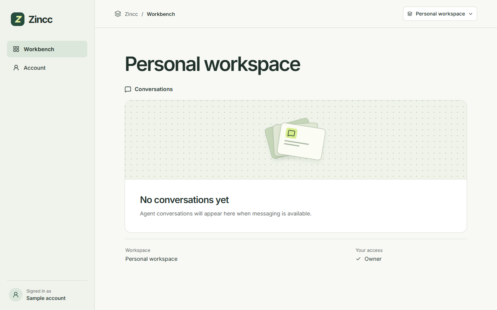

# Web workbench

The workbench has two views. **Workbench** shows the current workspace, membership role, and conversation area. **Account** shows the signed-in identity and provides switch-account and sign-out actions. The conversation area supports sending messages and recovering history. [Conversation setup and limits](conversations.md). The light/dark shell follows the device theme.



The screenshot uses fixture membership data. An actual user's workspace list comes from PostgreSQL.

## Run the packaged application

Use Node 26.13.1, pnpm 12.21.0 and the [project JDK](../../README.md). From the repository root on Windows:

```powershell
Set-Location frontend
pnpm install --frozen-lockfile
pnpm build
Set-Location ..
.\mvnw.cmd -Pworkbench verify
& "$env:JAVA_HOME/bin/java.exe" -jar target/zincc-control-plane-0.1.0-SNAPSHOT.jar
```

Open `http://127.0.0.1:8080/workbench/`. The default Spring profile shows the shell and explains how to enable sign-in. For real workspace access, apply migrations through V5 and configure the [OIDC profile](browser-sessions.md). Set its public base URL to the browser origin. The bundled application lands on the workbench after login. A plain backend build can still run independently. Use a clean build when switching Maven packaging profiles.

For frontend development, start Spring on port 8080 and run `pnpm dev` inside `frontend`. Open the Vite origin under `/workbench/`. The dev server proxies API, login and callback paths to Spring. Set `ZINCC_WORKBENCH_ENABLED=true` for the unbundled service and register the **Vite origin** as the public callback for that development client.

## Contract and verification

The [OpenAPI contract](../../frontend/openapi.json) defines the session, workspace and conversation endpoints. After changing it, run `pnpm generate`. The build checks that the generated file is current, type-checks, lints, and bundles the client. The client also checks response shapes at runtime.

After building, run `pnpm exec playwright install chromium` then `pnpm test:e2e`. To use an installed Edge browser instead, set `ZINCC_BROWSER_CHANNEL=msedge`. The browser tests use HTTP fixtures to exercise loading, invalid responses, retries, empty states, revoked access, keyboard navigation and account switching. The Java suite verifies real database filtering and the local OIDC flow. Windows x64 with Edge is the qualified browser environment for this task.
